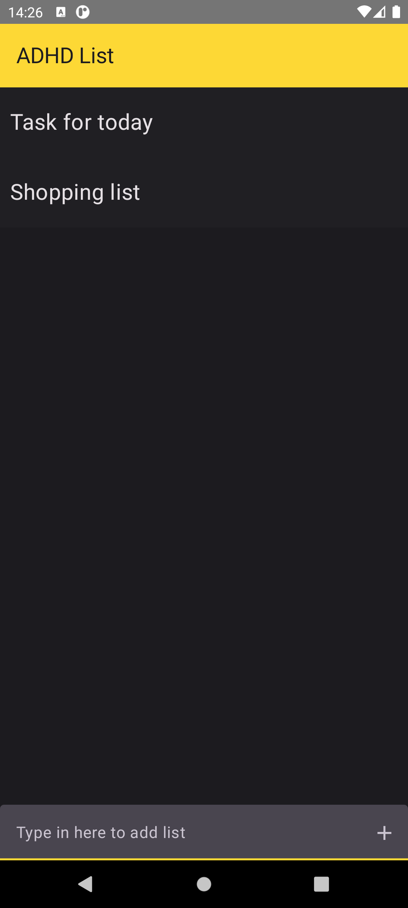

# ADHD List
ADHD List is a productivity-focused app designed,
to help people with ADHD easily manage quick notes and to-do lists.
The app focuses on simplicity and efficiency, making it easy to organise and focus on tasks.

### Features:
- Create and manage quick notes and to-do lists.
- Intuitive, distraction-free interface based on Jetpack Compose.
- Durable storage with Room Database for seamless data storage and offline operation.
- Scalable and maintainable code base using clean architecture principles.
- Shared lists: invite people with a code or link and edit the same list together (Firebase, works offline).
- Lists for anything (to do, to buy, to pack, to remember); items can have several lines.
- Press and hold an item to edit its text, or a list to rename it; drag the ═ handle to change the order.
- Deleting by swipe needs a long, deliberate swipe (most of the row); a short or quick swipe does nothing.
- Designed for AuDHD: the original ADHD List look (yellow top bar and accents on neutral greys) in light and dark mode, the same layout every time, a progress bar
  per list, big tap targets, a confirmation before deleting a list and Undo after deleting an item.

### Shared lists setup

Without Firebase config the app builds and works as before; the Share and Join buttons stay hidden.

1. Create a project at [console.firebase.google.com](https://console.firebase.google.com) (the free Spark plan is enough).
2. Add an Android app with package name `com.example.adhdlist` and put the downloaded
   `google-services.json` in `app/`.
3. **Authentication → Sign-in method:** enable **Anonymous** (people never see a sign-in screen).
4. **Firestore Database:** create a database in production mode.
5. Deploy the security rules from this repo **before** building with the config (until then, every
   share is refused and the list simply stays local):
   ```bash
   cd firebase && npm install && npx firebase login && npx firebase deploy --only firestore:rules --project YOUR_PROJECT_ID
   ```

How it works: the Share button uploads the list and opens the share sheet with a join code and an
`adhdlist://join/…` link. The other person opens the link, shares the message into ADHD List, or
types the code under **Join list**. Anyone with the code can join, so share it only with people you
trust; swiping a shared list away leaves it (it stays for the others).

**Local testing without a Firebase account** (uses the Firebase Emulator Suite on your computer):
```bash
cd firebase && npm install && npm run emulators
```
Then build with `-PfirebaseEmulatorHost=10.0.2.2` (Android emulator) or set `firebaseEmulatorHost=10.0.2.2`
in `~/.gradle/gradle.properties`. `npm test` in `firebase/` runs the security rules tests.

### Technology stack:
- Hilt: Dependency injection for modular and testable code.
- Room Database: Local data storage for notes and tasks.
- Jetpack Compose: A modern UI toolkit for creating responsive interfaces.
- Coroutines: Simplified asynchronous programming for a seamless user experience.

### Tests:
- Unit tests: `./gradlew :app:testDebugUnitTest`
- Instrumentation tests: `./gradlew :app:connectedDebugAndroidTest` (add `-PfirebaseEmulatorHost=10.0.2.2`
  with the emulators running to include the two-person sync test)
- Security rules tests: `cd firebase && npm test`
- How each screen's states and transitions work, and the bugs found in them: [docs/STATE_MACHINES.md](docs/STATE_MACHINES.md)

### Architecture:
- MVVM,
- Clean Architecture,

This is a repository demonstrating best practices for Android application development,
using high-level solutions and the latest technologies available.

### Application overview:

Translated with DeepL.com (free version)****

| Main screen when adding lists:                                    | Main screen with several lists:                                      | List screen with many tasks:                                      | List screen during deletion:                                         |
|-------------------------------------------------------------------|----------------------------------------------------------------------|-------------------------------------------------------------------|----------------------------------------------------------------------|
|  |      |     |  |
