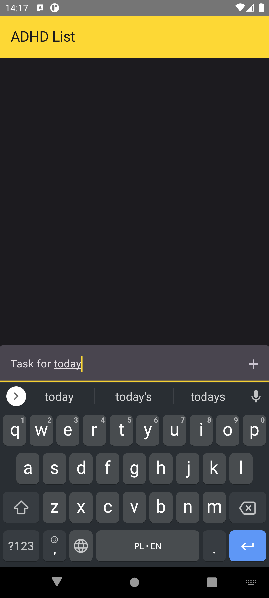
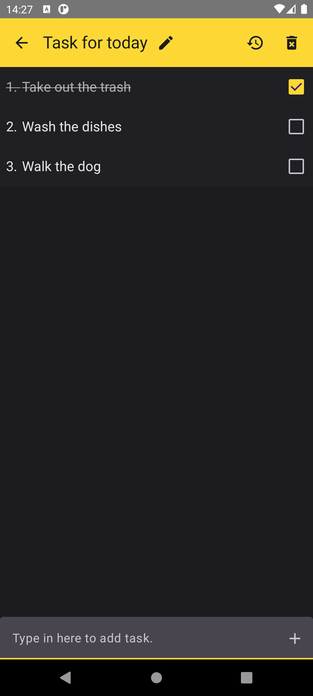
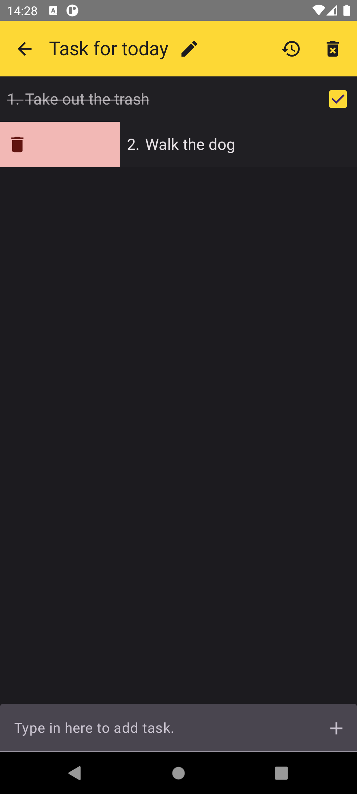

# ADHD List
ADHD List is a simple list app designed to help people with ADHD and AuDHD keep track of anything:
things to do, to buy, to pack or to remember. It focuses on calm, predictable screens and quick,
forgiving actions, so getting things out of your head takes as little effort as possible.

### Features

**Lists and items**
- Make as many lists as you like; each one shows "x of y ticked" and a progress bar.
- Items can have several lines (handy for things like exercise sets).
- Tap an item to tick it; the whole row is the tap target.
- Press and hold an item to edit its text, move it to another category, or delete it.
- Press and hold a list to rename it.
- The ⋮ menu offers **Uncheck all** while anything is ticked (it asks first) and **Check all** once nothing is.

**Categories (accordion)**
- One level of categories inside a list, e.g. Zakupy → Warzywa → Cukinia. Items without a category sit at the top.
- Tap a category to open or close it; the phone remembers which ones are open.
- **+** on a category makes new items go into it until you tap ✕.
- Press and hold a category to rename or delete it.

**Moving things**
- Drag the ═ handle to reorder lists and items.
- Drag an item into a category, out of it to the top of the list, or into another category.
  A closed category opens when you drag onto it.

**Deleting, safely**
- Swipe most of the way across a row to delete it; a short or quick swipe does nothing.
- Items: swipe, or press and hold → **Delete**. Both offer **Undo**.
- Categories: swipe the header, or press and hold → **Delete**. It asks first and also deletes the category's items.
- Lists: swipe, which asks first. A shared list is left, not deleted, so it stays for the others.
- **Delete checked** (⋮ menu) removes only the ticked items; it asks first and is greyed out while nothing is ticked.
- **Delete everything** (⋮ menu) asks first and is greyed out on an empty list.

**Shared lists**
- Invite people with a join code or link and edit the same list together, including its categories.
- Works offline: changes are kept on the phone and sent when it's back online.

**Designed for AuDHD**
- The original ADHD List look: a yellow top bar and accents on neutral greys, in light and dark mode.
- The same layout every time, big tap targets, labelled menus instead of mystery icons,
  and confirmations or Undo before anything is lost.

### Shared lists setup

Without Firebase config the app builds and works as before; the Share and Join buttons stay hidden.

1. Create a project at [console.firebase.google.com](https://console.firebase.google.com) (the free Spark plan is enough).
2. Add an Android app with package name `com.example.adhdlist` and put the downloaded
   `google-services.json` in `app/` (it is git-ignored).
3. **Authentication → Sign-in method:** enable **Anonymous** (people never see a sign-in screen).
4. **Firestore Database:** create a database in production mode.
5. Publish the security rules from [firebase/firestore.rules](firebase/firestore.rules), either way:
   - **Console:** Firestore Database → Rules → replace everything with the file's contents → **Publish**.
   - **Command line** (`firebase login` opens a browser, so run it in an interactive terminal):
     ```bash
     cd firebase && npm install && npx firebase login && npx firebase deploy --only firestore:rules --project YOUR_PROJECT_ID
     ```

**Republish the rules whenever `firestore.rules` changes.** Until you do, the server refuses the new
kinds of data; for example, categories in shared lists are refused while items keep syncing.

How it works: the Share button uploads the list and opens the share sheet with a join code and an
`adhdlist://join/…` link. The other person opens the link, shares the message into ADHD List, or
types the code under **Join list**. Anyone with the code can join, so share it only with people you trust.

**Local testing without a Firebase account** (uses the Firebase Emulator Suite on your computer):
```bash
cd firebase && npm install && npm run emulators
```
Then build with `-PfirebaseEmulatorHost=10.0.2.2` (Android emulator) or set `firebaseEmulatorHost=10.0.2.2`
in `~/.gradle/gradle.properties`. With that set, the app always uses a separate `demo-adhdlist` test
project, so test data can never reach your real one.

### Technology stack
- Jetpack Compose with Material 3 for the UI.
- Room for local storage, with tested migrations so updates keep everyone's lists.
- Firebase Firestore and Anonymous Auth for shared lists.
- Hilt for dependency injection; Kotlin Coroutines and Flow.
- [Reorderable](https://github.com/Calvin-LL/Reorderable) for drag-to-reorder.

### Architecture
- MVVM, Clean Architecture (screens → ViewModels → use cases → repositories).
- The screens only read Room. Shared lists are mirrored from Firestore into Room, so shared and
  local lists look the same to the UI and both work offline.
- How each screen's states and transitions work, and the bugs found in them: [docs/STATE_MACHINES.md](docs/STATE_MACHINES.md).

### Development
- **Database changes:** the app is in use, so every schema change needs a version bump, a `Migration`
  in `TaskDatabase` and a case in `MigrationTest`. There is no destructive fallback: a missing
  migration fails in testing instead of wiping users' lists.
- **Unit tests:** `./gradlew :app:testDebugUnitTest`
- **Device tests:** `./gradlew :app:connectedDebugAndroidTest`. They wipe and uninstall the app on
  **every connected device**, so point them at one emulator:
  ```bash
  ANDROID_SERIAL=emulator-5554 ./gradlew :app:connectedDebugAndroidTest
  ```
  Add `-PfirebaseEmulatorHost=10.0.2.2` with `npm run emulators` running to include the two-person sync tests.
- **Security rules tests:** `cd firebase && npm test`

### Application overview

Screenshots from the first version of the app:

| Main screen when adding lists:                                    | Main screen with several lists:                                      | List screen with many tasks:                                      | List screen during deletion:                                         |
|-------------------------------------------------------------------|----------------------------------------------------------------------|-------------------------------------------------------------------|----------------------------------------------------------------------|
|  |      |     |  |
